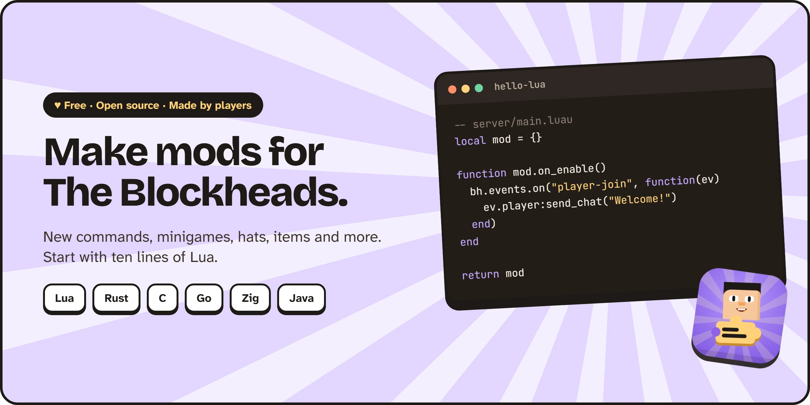
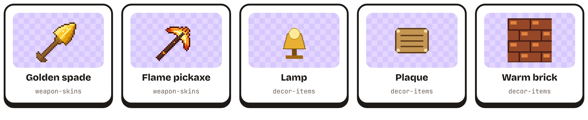
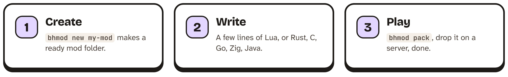

<p align="center">
  <a href="https://blockheads.club/docs/mods">
    
  </a>
</p>

<p align="center">
  <a href="https://github.com/Blockheads-Club/mod-sdk/actions/workflows/ci.yml"></a>
  <a href="https://github.com/Blockheads-Club/mod-sdk/stargazers"></a>
  <a href="https://blockheads.club/mods"></a>
  <a href="LICENSING.md"></a>
</p>

<h3 align="center">
  <a href="https://blockheads.club/docs/mods/first-lua-mod">🚀 Your first mod</a>
  &nbsp;·&nbsp;
  <a href="https://blockheads.club/docs/mods/api/">📚 API docs</a>
  &nbsp;·&nbsp;
  <a href="https://blockheads.club/mods">🧩 Browse mods</a>
  &nbsp;·&nbsp;
  <a href="https://github.com/Blockheads-Club/mods">📦 Publish yours</a>
</h3>

<br>

Add new commands, chat tools, minigames, shops, land claims, hats, items and weapon skins to The Blockheads. Mods
run on the server, on the player's game, or on both. Players who join a modded server see the list of mods, say yes,
and the client part downloads straight from the server.

> [!NOTE]
> **Preview.** The [Blockheads Server](https://github.com/Blockheads-Club/blockheads-server), the
> [PC client](https://github.com/Blockheads-Club/blockheads-pc) and the Android mod loader (installed with the
> [Patcher](https://github.com/Blockheads-Club/blockheads-patcher)) already run mods. Things may still change before 1.0.

## ✨ What you can make

<table>
  <tr>
    <td width="50%" valign="top">
      <h3>💬 Commands and chat</h3>
      Your own <code>/commands</code>, chat filters, welcome messages, reminders and countdowns.
    </td>
    <td width="50%" valign="top">
      <h3>🎯 Gameplay</h3>
      React to blocks placed and broken, damage, deaths and movement. Cancel what you don't want.
    </td>
  </tr>
  <tr>
    <td valign="top">
      <h3>🎩 New things to see</h3>
      Hats, hair, decoration items, blocks and weapon skins with your own pixel art.
    </td>
    <td valign="top">
      <h3>🖼️ On-screen UI</h3>
      HUD elements, toasts, dialogs and a settings page for your mod.
    </td>
  </tr>
  <tr>
    <td valign="top">
      <h3>🤝 Mods that work together</h3>
      Services, events and channels: a shop can use an economy mod, a client mod can ask the server.
    </td>
    <td valign="top">
      <h3>🔐 Safe for players</h3>
      Sandboxed Lua and WASM, permissions the server owner grants, time budgets, and a reviewed public list.
    </td>
  </tr>
</table>

<p align="center"></p>

## 🚀 Your first mod in 3 steps

<p align="center"></p>

Install the `bhmod` tool (needs [Rust](https://rustup.rs)):

```bash
cargo install --git https://github.com/Blockheads-Club/mod-sdk bhmod
```

**Lua (easiest):**

```bash
bhmod new my-mod             # creates my-mod/ with mod.toml and server/main.luau
cd my-mod
bhmod check .                # finds mistakes in mod.toml and the files
bhmod pack .                 # builds my-mod-0.1.0.bhmod
```

**Rust (WASM):**

```bash
rustup target add wasm32-wasip2
bhmod new my-mod --lang rust
cd my-mod && ./build.sh && bhmod pack .
```

Copy the `.bhmod` (or the unpacked mod folder) into the server's mods folder (`<data dir>/mods/`, or
`BLOCKHEADS_MODS_DIR`) and grant the permissions it asks for in `mods.toml` there:

```toml
[hello-lua]
grant = ["players:chat"]
```

Step by step: [your first Lua mod](https://blockheads.club/docs/mods/first-lua-mod) and
[your first Rust mod](https://blockheads.club/docs/mods/first-rust-mod). Done? [Publish it](https://github.com/Blockheads-Club/mods)
so everyone can find it.

## 🧪 Examples to copy

Every basic example comes as a Lua and a Rust twin that behave exactly the same (a test checks it).

| Example | What it does |
| --- | --- |
| [`hello-lua`](examples/hello-lua) / [`hello-rust`](examples/hello-rust) | `/hello`, greets players who join |
| [`chat-filter`](examples/chat-filter) / [`chat-filter-rust`](examples/chat-filter-rust) | Cancels and rewrites chat |
| [`scheduler-lua`](examples/scheduler-lua) / [`scheduler-rust`](examples/scheduler-rust) | `/countdown`, `/remind` |
| [`prices-lua`](examples/prices-lua) / [`prices-rust`](examples/prices-rust) | A client mod asks a server mod for prices (`/price <item>`) |
| [`economy`](examples/economy), [`shop-rust`](examples/shop-rust), [`shop-java`](examples/shop-java) | Money and a shop that uses it |
| [`landclaim`](examples/landclaim) | Protect your land |
| [`hud-lua`](examples/hud-lua) / [`hud-rust`](examples/hud-rust), [`settings-lua`](examples/settings-lua) | On-screen UI and mod settings |
| [`cosmetics-hats`](examples/cosmetics-hats), [`decor-items`](examples/decor-items) | Hats, hair and decoration ([`docs/content.md`](docs/content.md)) |
| [`weapon-skins`](examples/weapon-skins) | Re-skins the held tool (PC client, native tier) |
| [`voice-rust`](examples/voice-rust) | Voice chat ([`docs/voice.md`](docs/voice.md)) |

More languages: Rust, C, Zig and Go in [`docs/wasm.md`](docs/wasm.md); Java and Kotlin in [`docs/jvm.md`](docs/jvm.md)
(unsandboxed, so they need the `native` permission and a host with JVM support turned on). Native mods hook the game
itself through a small C ABI and load only from the reviewed index, after the player confirmed a red warning:
[`docs/native.md`](docs/native.md).

## 🧱 Part of Blockheads Club

<table>
  <tr>
    <td align="center" width="25%"><a href="https://github.com/Blockheads-Club/blockheads-server"><br><b>Server</b></a><br><sub>Runs your server mods</sub></td>
    <td align="center" width="25%"><a href="https://github.com/Blockheads-Club/blockheads-pc"><br><b>Blockheads PC</b></a><br><sub>Runs client mods on PC</sub></td>
    <td align="center" width="25%"><a href="https://github.com/Blockheads-Club/blockheads-patcher"><br><b>Patcher</b></a><br><sub>Installs the Android loader</sub></td>
    <td align="center" width="25%"><a href="https://github.com/Blockheads-Club/mods"><br><b>Mods</b></a><br><sub>The public mod list</sub></td>
  </tr>
</table>

<p align="center">All apps, guides and downloads: <a href="https://blockheads.club"><b>blockheads.club</b></a></p>

## 🛠️ What's inside

<details>
<summary><b>Repository map</b></summary>
<br>

| Path | What |
| --- | --- |
| [`wit/blockheads-api/`](wit/blockheads-api/) | The mod API (`blockheads:api@0.3.1`, WIT): events (incl. gameplay), commands, scheduler, storage, players, services (also across the network, client <-> server), channels, client UI (HUD, toasts, dialogs), mod content (items, blocks, cosmetics); the frozen 0.1, 0.2 and 0.3.0 copies are in [`wit/compat/`](wit/compat/) |
| [`docs/luau-api.md`](docs/luau-api.md) | How the API looks from Lua |
| [`docs/wasm.md`](docs/wasm.md) | WASM mods: Rust SDK, C/Zig/TinyGo, how the host runs them, the conformance suite |
| [`docs/jvm.md`](docs/jvm.md) | JVM mods: Java/Kotlin SDK (generated from the WIT), how the host runs them, Android (ART) |
| [`sdk/rust/blockheads-mod`](sdk/rust/blockheads-mod) | The Rust SDK (bindings + closures for events, commands, tasks) |
| [`docs/native.md`](docs/native.md) | Native mods: the `libbhmod` C ABI and header, hook kinds, who may load native code, weapon skins |
| [`docs/package.md`](docs/package.md) | The `.bhmod` package and its rules |
| [`docs/hot-reload.md`](docs/hot-reload.md) | Hot reload of single mods, the time accounting (`/mods timings`), the developer watcher |
| [`schema/`](schema/) | JSON Schemas for `mod.toml`, index entries and the published `index.json` |
| [`docs/protocol-0xbc.md`](docs/protocol-0xbc.md), [`vectors/`](vectors/) | Client ⇄ server mod protocol and its byte-exact test vectors |
| `crates/bhmod-manifest` | Reads and checks `mod.toml` and packages |
| `crates/bhmod-proto` | Encodes and decodes the 0xBC protocol |
| `crates/bhmod-cli` | The `bhmod` tool (`check`, `pack`, `new`, `index`) |
| `crates/bhmod-native` | The `libbhmod` ABI, the armv7 inline-hook relocator and the hook engine both clients share |
| `crates/bhmod-index` | Checks, builds and signs the public mod index ([`docs/index.md`](docs/index.md)) |
| `crates/bhmod-core` | The shared mod host (GPL, built from M1 on) |
| `crates/bhmod-wasm` | The WASM runtime of the host: wasmtime, Cranelift / Pulley, deadlines, memory limits, compile cache (GPL) |
| `crates/bhmod-voice` | Voice chat core of the hosts: session crypto, frame layouts, server relay, jitter buffer, mixer, VAD (GPL; no audio devices) |

The `bhmod new` templates (Luau, Rust, Java) carry a commented-out example of a `remote = true` service in `mod.toml`
and the entry file, and a README section with the limits.
</details>

<details>
<summary><b>Developing the SDK</b></summary>
<br>

`scripts/build-wasm.sh` (needs `rustup target add wasm32-wasip2`), then `cargo test --workspace`. CI also runs
clippy, rustfmt, the WIT check, the examples, the Luau ⇄ WASM conformance suite and a 100 % line coverage gate
(`cargo llvm-cov --workspace --ignore-filename-regex 'bhmod-wasm/src/wit' --fail-under-lines 100`; the excluded files
hold only wasmtime's generated bindings).
</details>

## ⚖️ License

Your mod is yours: pick any licence you like. The API, schemas, tools and examples here are `MIT OR Apache-2.0`;
`bhmod-core`, `bhmod-wasm` and `bhmod-voice` are GPL-3.0-or-later with an exception for mods. Details:
[LICENSING.md](LICENSING.md).

Not affiliated with Majic Jungle or Noodlecake. Mods must not include original game files.
